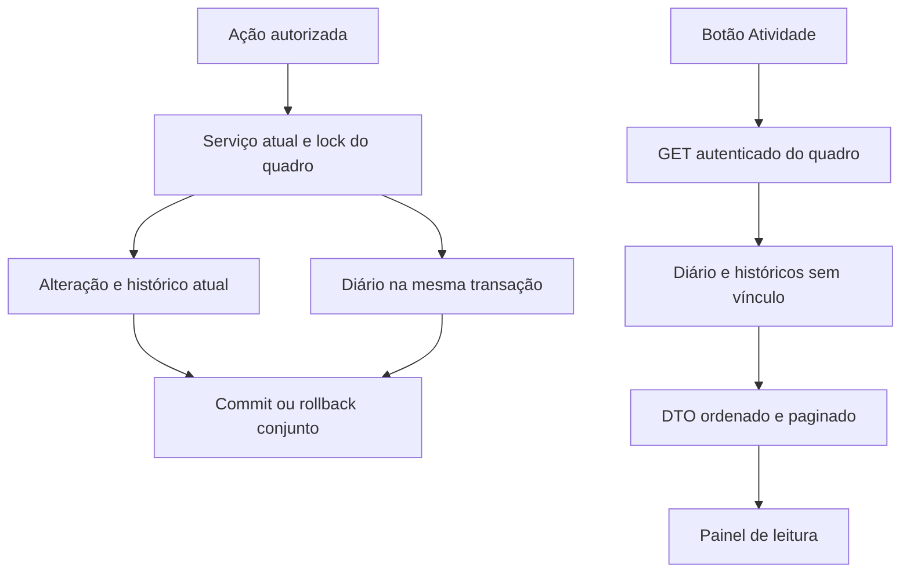

# Atividade por gerenciamento Design

**Spec:**spec.md. **Status:**Approved pelo usuário em10/10/2026 junto com spec/tarefas/defaults. AD-001–034 respeitadas; nenhuma decisão antiga supersedida. Ferramentas AD-024 mantidas. Contexto e código local são a fonte das escolhas; nenhuma biblioteca nova necessária.

## Architecture Overview

Recomendo um diário adicional de atividade, gravado na mesma transação da ação. O histórico das demandas continua existindo; o evento novo guarda seu ID para a consulta não repetir a ação. Registros históricos sem esse vínculo são consultados como Histórico existente, com conteúdo literal e sem antes/depois reconstruído.

| Abordagem, mesmo alcance | Vantagens | Custos |
| --- | --- | --- |
| Diário adicional + vínculo único com histórico, recomendada | Preserva os contratos e registros atuais; snapshots de etapas removidas; comentários não alteram histórico/versão | Nova tabela, duas fontes na leitura e testes de paginação |
| Ampliar Historico para quadro/etapa/demanda/comentário | Fonte única para ordenar | Modifica a entidade exposta nas APIs antigas e introduz novos registros no histórico de demandas; compatibilidade COM-12 exigiria segregação adicional |
| Diários separados para cada tipo de alvo, reunidos na leitura | Persistência específica por alvo | Quatro modelos e consulta de mais fontes para o mesmo resultado; maior custo de teste e manutenção |

Usuário confirmou a proposta recomendada e exatamente as três adequações de testes da T13. Implementação local autorizada, sem operação externa.

## Code Reuse Analysis

| Código existente | Uso |
| --- | --- |
| SessaoService.exigirUsuario / GerenciamentoGuard | Autor real, consulta autenticada, locks e autorização das ações preservados |
| GerenciamentoService, EtapaService, ProcessoService | Instrumentar operações centrais já transacionais; rotas modernas/antigas convergem |
| HistoricoService.registrar | Continuar histórico automático da demanda e capturar ID retornado para vínculo |
| ComentarioService.gravar | Acrescentar evento sem texto na mesma transação e horário do comentário, precisão micros |
| ApiException / handlers atuais |401/404/400/409 sem contrato novo de erro |
| api.js requisicao / validações de comentários | HTTP, abort e validação estrita de DTO |
| ComentariosLateral / Quadro / index.css | Acessibilidade, foco, painel, coordenação e arquivo; novo painel separado para consulta |
| ApiIntegrationSupport / runners isolados | Fixtures H2 e MySQL fictício; E2E Edge sem tocar banco configurado |

## Components

| Componente principal | Responsabilidade e interface |
| --- | --- |
| model/Atividade.java | Entidade adicional, sem setters públicos usados por controller e sem endpoints de escrita |
| service/AtividadeRegistroService.java | registrar(quadro, autorDaSessao, tipo, alvo, alteracoes, historicoId, horario); exigir transação existente, salvar snapshots e calcular diferenças determinísticas |
| Serviços atuais | Capturar antes depois de obter lock, aplicar alteração existente e gravar evento antes do commit; não capturar uma entidade antes do lock da autorização |
| service/AtividadeService.java | listar(token, quadroId, cursor); validar sessão, bloquear quadro para leitura consistente, consultar conjunto limitado e criar DTO sem mutação |
| controller/AtividadeController.java | Apenas GET /api/gerenciamentos/{id}/atividade?cursor=…, encaminhando token conforme controller de comentários |
| frontend/src/services/api.js | consultarAtividade(id,cursor,{signal}); validar contrato antes de retornar |
| frontend/src/components/AtividadeLateral.jsx | Painel, páginas, atualização, erro, texto literal, foco, abort e respostas tardias |
| frontend/src/pages/Quadro.jsx | Botão no cabeçalho, ID do quadro e exclusão mútua com formulários/comentários, inclusive arquivo |

Não introduzir referência do writer a EtapaService/GerenciamentoService: evita ciclos. Dependências do writer são repositório, relógio/serializador e valores já autorizados. DTOs e controller são wiring de leitura, sem lógica de autorização duplicada.

## Data Models

Tabela atividades: id gerado; gerenciamento_id FK obrigatória; tipo; alvo_tipo QUADRO/ETAPA/DEMANDA; alvo_id; alvo_nome snapshot; autor_id; autor_nome snapshot; data_hora com micros; alteracoes_json TEXT/LONGTEXT; historico_id nullable com unicidade para vínculo. Alvo da demanda usa número, não o cliente mutável. Índice por gerenciamento/data_hora/id. Não criar FK para alvo ou autor; remoção de etapa não remove o registro. A tabela não recebe cascade de exclusão de etapa/demanda/usuário.

Alteração: `{alvoTipo,alvoId,alvoNome,campo,anterior,novo}`. Valores são string ou null; datas ISO locais, booleanos true/false, ordens decimais; etapas usam campo etapaId e etapaNome para conservar IDs e nomes. Campos em ordem fixa: quadro nome/descricao/arquivado; etapa nome/setor/ordem; demanda numeroProcesso/pessoa/responsavel/prioridade/dataEmissao/prazoEtapa/prazo/observacao/status/etapaId/etapaNome/dataConclusao/dataCancelamento/motivoCancelamento/arquivado. Somente campos aplicáveis à ação e com valores diferentes entram. Criações registram valores iniciais não nulos; exclusão usa valores anteriores não nulos para null. Reordenação inclui cada alvo envolvido, ordenado por ID para desempatar.

DTO de página: `{gerenciamentoId,registros,proximoCursor}`. Cada registro: `{chave,origem,id,gerenciamentoId,tipo,alvoTipo,alvoId,alvoNome,autorId,autorNome,dataHora,descricao,alteracoes}`. Chave prefixada AUTOMATICA:id ou HISTORICO_EXISTENTE:id. No automático, tipo pertence ao enum ACT-01–14, IDs positivos seguros, autor e horário obrigatórios, descricao nula (texto humano derivado do tipo na UI). No existente, tipo recebe acao literal, descricao e autor/data admitem null, autorId nulo, alteracoes vazias. Não converter nomes de ação desconhecidos em eventos confiáveis.

GET vazio200 com registros[] e proximoCursor null. Cursor opaco Base64 URL de quadroId, máximoIdAtividade, máximoIdHistorico e deslocamento; tamanho até512, números seguros >=0, quadroId positivo e igual à rota. Não contém senha/token. Limite fixo50; buscar51 para determinar continuação. Na primeira página, obter máximos sob lock do quadro; posteriores filtram ambos os IDs máximos. Consulta nativa parametrizada, UNION ALL diário + históricos via processo/etapa/quadro e NOT EXISTS vínculo no diário, com ordem ACT-25, limite/deslocamento. Não interpolar cursor em SQL. Datas nulas explicitamente por último. Todos os campos históricos lidos diretamente, sem backfill ou UPDATE.

As fontes são imutáveis pelas rotas consultadas: não há ação que vincule um evento novo a histórico antigo. Assim máximos fixos e ordenação mantêm páginas estáveis mesmo com novas inserções. Intervenção direta no banco fica fora da garantia. Consulta pode usar JdbcTemplate (já disponível no projeto) para UNION; JPA continua escrevendo na transação atual. Provar o SQL nos dois bancos antes da conclusão.

## Compatibility and operation capture

- Criação do quadro gera um evento de criação, incluindo snapshot das etapas iniciais; as finais automáticas não viram falsas ações de criação de etapa.
- Edição/arquivo do quadro captura valores após lock; salvamento idêntico conserva incremento atual, mas alterações[]. Arquivo idempotente conserva ausência de mudança/evento.
- Etapas capturam sequência anterior, inclusive ordem irregular, antes de confirmar/normalizar; evento inclui efeitos de todas as posições alteradas. Remoção grava snapshot sem depender da entidade deletada.
- Demandas usam salvarInicial, executarEdicao, executarTransicao e mudarArquivo para garantir cobertura das rotas antigas. Vínculo recebe apenas o histórico da própria operação, novo e no mesmo quadro. Datas/motivo limpos ao reabrir aparecem como valor para null.
- Comentário recebe evento no caminho gravar e o mesmo horário truncado a micros. Não gravar texto, histórico de demanda nem forçar versão do quadro.
- Proposta de ACT-24: registrarExterno conserva as verificações de existência e arquivo, depois recusa409 em demanda ativa. registrar interno permanece para ações reais. Consulta histórica antiga permanece. Nenhum acesso ao banco real nem preparação retroativa automática.

## Error Handling Strategy

| Falha | Resposta e efeito |
| --- | --- |
| Falha do writer, constraint ou serialização | Propagar exceção para rollback integral; não capturar para seguir salvando ação |
| Sessão/quadros/cursor |401/404/400; nenhuma escrita durante leitura |
| Recusa da ação ou arquivo | Mensagens/precedências existentes; nenhum evento de sucesso |
| Resposta inválida | API cliente rejeita página inteira; painel conserva conjunto anterior, sem mesclar |
| Erro de primeira leitura | Erro + Tentar novamente; nunca mostrar registros de outro quadro |
| Erro ao carregar mais/atualizar | Conservar lista anterior; retry explícito, duplo clique bloqueado |
| Fechamento ou mudança de quadro | Abort + identificação da requisição; ignorar resposta mesmo se transporte desconsiderar abort |

## Risks & Concerns

| Concern | Location (file:line) | Impact | Mitigation |
| --- | --- | --- | --- |
| Autor/ação manuais escolhidos pelo cliente | HistoricoController.java:25; HistoricoService.java:38 | Registro pode parecer ação comprovada | ACT-22 diferencia origem; ACT-24 proposto recusa escrita nova; autorização exata de testes |
| Métodos centrais grandes e rotas antigas | ProcessoService.java:139/253/371/408 | Captura incompleta ou evento duplicado | Um writer por operação central; testes parametrizados modernos/antigos e contagem exata |
| Leitura antes de lock | GerenciamentoGuard e serviços de ação | Antes/depois incorreto em corrida de arquivo/restauração | Capturar após lock; testes com transações coordenadas, sem sleep como prova |
| Longas observações | ProcessoService valida10000; Atividade nova | Truncamento de antes/depois | Coluna larga para JSON; teste literal10000 antes e depois em H2/MySQL |
| Remoção e nomes posteriores | EtapaService.java:103 | Evento some ou muda de significado | Snapshots escalares, sem FK/cascade ao alvo; teste remover/renomear/reler |
| Histórico e atividade duplicados | HistoricoRepository.findByProcessoIdOrderByDataHoraAsc | Duas linhas para uma ação | historico_id único + exclusão na união; teste rollback e fontes mistas |
| Resposta crescente e novos inserts | GET novo | Lista ilimitada ou páginas repetidas | Limite50, máximos das fontes, ordem explícita, testes empates/nulos/inserts |
| Limpeza das fixtures | ApiIntegrationSupport.java:30 | FK impede reset entre testes | Deletar atividade antes dos pais; manter helper antigo de conteúdo e criar captura adicional para provas novas |
| Registros não abrangidos pelos snapshots antigos | ApiIntegrationSupport.java:76 | Falso PASS de rollback | Novos testes incluem tabela atividade e quadro, além de todas as tabelas atuais |
| Painel e foco/rascunhos | Quadro.jsx:74/188/307 | Descarte acidental ou ações simultâneas | Exclusão mútua e tests pendente/fechamento; header não altera lista de botões dos cartões |
| Stylesheet inativo | CSS do painel anterior | Painel compila mas não aparece corretamente | Usar index.css carregado; navegador desktop/360px e capturas |

## Tech Decisions

- Usar stack e runners locais já aprovados. Sem upgrade, fila, evento assíncrono ou biblioteca nova.
- Diário transacional independente, DTO plano e consulta das duas fontes; teste real em MySQL fictício.
- 18 entregáveis atômicos no plano, gates por camada, commits individuais e Verifier fresco obrigatório após a última tarefa.
- Sem promoção de lições candidatas: confirmed vazio. Risco já observado no sensor anterior orienta novas provas de lock, sem afirmar lição confirmada.
